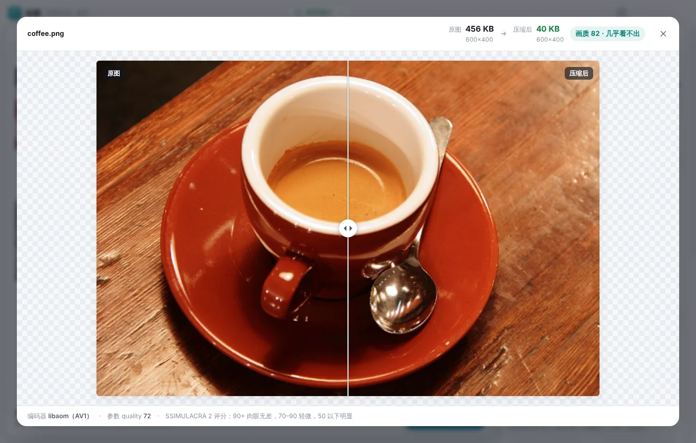

# 轻图

批量图片压缩 + 裁切的桌面软件（Windows / macOS）。主打两件事：**画质优先、能省就省**，以及**界面好看、操作顺手**。


| 深色模式 | 压缩前后对比 |
|---|---|
|  |  |

## 能做什么

- **批量导入**：拖图片或整个文件夹进来（自动扫描子目录），也可以点按钮选。
- **输出格式**：原格式 / JPG / PNG / WebP / AVIF / JPEG XL。
- **智能画质**（默认）：每张图用 SSIMULACRA 2 感知评分打分，自动找“刚好达标”的最低参数。四档目标：视觉无损（≥90）、高画质（≥82）、均衡（≥75）、小体积（≥65）。也可以切成手动参数。
- **限制文件大小**：比如“每张 ≤ 500 KB”。先降画质；还超标且允许的话再等比缩小尺寸。精确尺寸模式下只降画质，绝不改尺寸。
- **按分辨率裁切**：裁切填满（支持智能识别主体或九宫格定位）、留白适应、限制最大尺寸、拉伸、按比例；内置 1920×1080、800×800、一寸照等常用尺寸。
- **导出方式**：原图旁新建文件夹 / 统一导出到指定文件夹（可保留子目录结构）/ 覆盖原图（默认先把原图移入回收站）。
- **文件命名**：原文件名 / 默认（`原名_compressed`）/ 自定义模板（`{name}` `{n}` `{w}` `{h}` `{date}` `{time}` `{folder}` `{fmt}`，序号可设起始值和位数），界面实时预览。
- **场景预设**：电商主图、报名证件照、公众号封面、网页图片等，一键套用；也能把当前设置存成自己的预设。
- **压缩前后对比**：拖动滑块对比原图和结果，显示体积、尺寸和画质分。
- 自动按拍摄方向摆正照片；默认去掉 EXIF / GPS 等隐私信息；压完反而变大时保留原图；遇到同名文件可选自动改名 / 跳过 / 覆盖；处理在后台线程进行，界面不卡。

## 用到的压缩技术

| 用途 | 技术 | 说明 |
|---|---|---|
| JPG 编码 | **Jpegli**（Google，2024） | 输出标准 JPEG，任何软件都能打开 |
| AVIF 编码 | libaom（AV1） | sharp 0.35 默认启用 libaom 的静态图调优（实测与 `tune=iq` 体积一致） |
| JPEG XL | **libjxl 0.12** | 编码、解码、JPG 无损转码（平均小约 20%，可还原原 JPG） |
| WebP / PNG | libwebp / libimagequant | PNG 低于 100 画质时走调色板量化 |
| 画质评分 | **SSIMULACRA 2** | rust-av/ssimulacra2 编译成 wasm，与 libjxl 官方工具对照误差 ≤ 0.05 |
| HDR 照片 | ISO 21496-1 增益图 | JPG → JPG 时尝试保留（sharp 实验功能） |

Jpegli、libjxl、SSIMULACRA 2 都编译成了 WebAssembly（`src/vendor/`），所有平台共用同一份。

同等感知画质下的实测体积（8 张实拍照片，相对最常见的 mozjpeg JPG）：AVIF 小 33%–36%，JPEG XL 小 21%–30%，WebP 小 10%–13%，Jpegli 小 1%–5%。详见 [docs/benchmark.md](docs/benchmark.md)。

## 下载安装包

每次推送代码后，GitHub Actions 会自动打包：打开仓库的 **Actions → 轻图 · 测试与打包**，在最新一次运行的 Artifacts 里下载：

- `qingtu-Windows`：安装版 `Qingtu-Setup-*.exe` 和免安装版 `Qingtu-Portable-*.exe`
- `qingtu-macOS`：`Qingtu-*-arm64.dmg`（Apple 芯片）

安装包没有做代码签名：Windows 可能弹出 SmartScreen，点“更多信息 → 仍要运行”；macOS 首次打开请右键 → 打开，或在“系统设置 → 隐私与安全性”里允许。

## 本地开发

需要 Node.js 22。

```bash
cd qingtu
npm install
npm start          # 启动软件
npm test           # 跑测试
npm run dist:win   # 打 Windows 包（在 Windows 上执行）
npm run dist:mac   # 打 macOS 包（在 Mac 上执行）
```

重新编译 wasm 编码器：`native/build.sh`（需要 Rust、CMake 和 emsdk，产物已提交，平时不需要）。

## 目录结构

```
src/
  main.js / preload.js   Electron 主进程与安全桥
  core/                  压缩核心（可脱离 Electron 单独测试）
    processor.js           解码、裁切、编码、智能画质搜索
    quality.js / ssim2.js  感知画质评分
    codecs.js              Jpegli / libjxl 的 wasm 封装
    job.js                 批量任务：输出路径、命名、冲突、覆盖
    pool.js / worker.js    后台线程池
  renderer/              界面
  vendor/                编译好的 wasm
native/                  wasm 编码器的源码与构建脚本
scripts/bench-codecs.js  编码器实测脚本
```

## 已知限制

- 智能画质要对每张图反复“编码 → 解码 → 打分”，比固定参数慢；大图只抽 4 块代表性区域打分。
- HDR 增益图保留依赖 sharp 的实验接口，还没用真实手机 HDR 照片验证；不支持的情况会自动退回普通 JPG，并在对比窗口里提示。
- JPEG XL 输出暂不写入 EXIF。
- 不支持 HEIC（iPhone 默认格式）输入。
- macOS 只打 Apple 芯片的包；Intel Mac 需要在本机 `npm run dist:mac` 自行打包。
- Linux 下 sharp 与 Electron 自带的 GLib 存在已知冲突，会刷一堆警告；软件的主要目标平台是 Windows / macOS。
